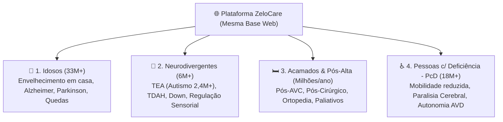
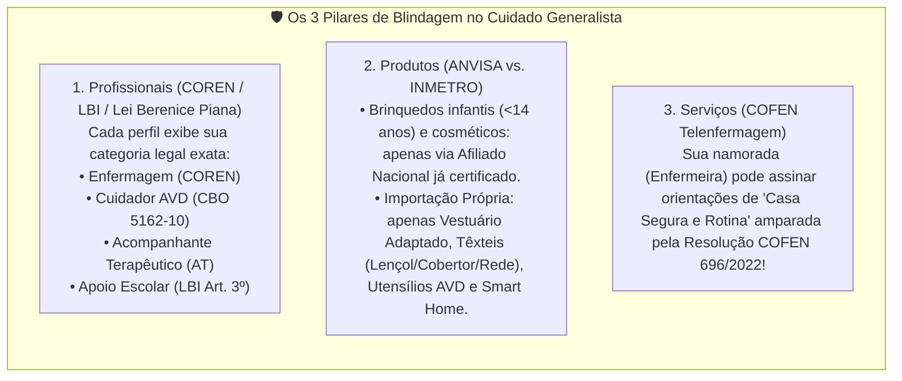

# Nova Rodada de Investigação: A Economia do Cuidado Ampliada (Idosos, Neurodivergentes, Acamados e PcD)

Ao expandir a visão do projeto de "apenas idosos" para **Cuidados Generalistas e Adaptação da Vida Diária**, o mercado endereçável no Brasil salta de 33 milhões para **mais de 55 milhões de pessoas**, conectando **4 públicos de altíssima demanda** que compartilham a mesma estrutura tecnológica (Cartão Verificado + Receituário de Kits + Diário Digital + Compra Coletiva).

---

## 1. Os 4 Universos do Cuidado Generalista no Brasil

### Por que unir esses 4 públicos é uma jogada estratégica genial?
1. **A dor da família é idêntica:** Em todos os 4 casos, a família precisa de:
   - Um **profissional de confiança verificado** (seja uma Enfermeira, um Cuidador de Idosos, uma **Acompanhante Terapêutica - AT** para autismo, ou um **Mediador Escolar**);
   - Um **Diário Digital de Comunicação** (pais de crianças autistas ou não-verbais têm a **mesma angústia** dos filhos de idosos: *"Como meu filho passou o dia na escola/terapia? Teve crise sensorial? Comeu?"*);
   - **Produtos específicos de rotina, ergonomia e adaptação** que não existem em lojas comuns.
2. **Multiplica nossa rede de "Profissionais Indicadores" (Afiliados B2B2C):**
   - Além de **Enfermeiros e Cuidadores**, passamos a atrair **Terapeutas Ocupacionais (TOs)**, **Fisioterapeutas**, **Fonoaudiólogos**, **Acompanhantes Terapêuticos (ATs ABA/Denver)** e **Mediadores Escolares** — profissionais que prescrevem listas inteiras de materiais sensoriais e adaptados toda semana!

---

## 2. Quadro Geral de Ideias e Oportunidades (Avaliação de Potencial vs. Risco)

Abaixo estão **8 oportunidades concretas de negócios/ferramentas** dentro do cuidado generalista, comparadas por investimento, margem e risco legal:

| # | Ideia / Oportunidade de Negócio | Público-Alvo | Como Funciona na Prática | Margem / Potencial de Receita | Risco Legal / Regulatório (E Como Blindar) |
| :--- | :--- | :--- | :--- | :---: | :--- |
| **1** | **Receituário Sensorial & Autonomia (TEA / TDAH)** | Pais de autistas, TOs, ATs e Fonoaudiólogos | Terapeuta Ocupacional ou AT monta o "Kit de Regulação Sensorial e Rotina Visual" da criança/jovem e envia aos pais no WhatsApp. | 🟢 **Altíssima** *(Pais de TEA investem pesado e recorrente)* | 🟡 **Atenção ao INMETRO (Portaria 302/21):** Brinquedos infantis exigem selo INMETRO para importar. **Blindagem:** Vender brinquedos via Afiliado Nacional (Amazon/ML) e importar apenas **têxteis/mobiliário/organizadores** (redes de lycra, cobertores pesados, timers visuais, abafadores). |
| **2** | **Kits de "Alta Hospitalar Expressa" (48h)** | Pacientes pós-AVC, pós-cirurgia ortopédica, acamados | Enfermeira de transição hospitalar envia o checklist antes do paciente sair do hospital (*Kit Quarto Acamado* + *Kit Banho a Seco*). | 🟢 **Alta** *(Ticket médio de R$ 350 a R$ 800 por alta)* | 🟢 **Baixo (ANVISA):** Focar em higiene prática (toucas de banho a seco registradas nacionalmente), lençóis deslizantes, cunhas de espuma de posicionamento e protetores impermeáveis. |
| **3** | **Moda Inclusiva & Vestuário Adaptado (*Adaptive Wear*)** | Acamados, Cadeirantes, Pós-operatório e Autistas (hipersensibilidade tátil) | Roupas com abertura total em velcro/ímã (veste o acamado sem levantar os braços!) e roupas sem costura/etiqueta para autistas. | 🟢 **Altíssima (150%–300%)** *(Oceano azul no Brasil)* | 🟢 **Risco Zero na ANVISA e INMETRO:** Vestuário comum adaptado não é dispositivo médico nem brinquedo! Pode ser importado ou confeccionado sob demanda com facilidade total. |
| **4** | **Cartão Verificado de ATs (Acompanhantes Terapêuticos) & Mediadores Escolares** | Famílias de crianças neurodivergentes e Escolas Particulares | Diretório com checagem de antecedentes criminais (PF/Estadual), formação em ABA/Psicologia/Enfermagem e depoimentos de mães verificadas. | 🟢 **Alta (SaaS R$ 24,90/mês + Escolas B2B)** | 🟡 **Lei Berenice Piana (12.764/12) e LBI (13.146/15):** Separar no perfil quem é **AT Clínico (Saúde/ABA)**, quem é **Mediador Pedagógico** e quem é **Profissional de Apoio Escolar (higiene/locomoção)**. Sem intermediar salário. |
| **5** | **Diário Digital "Casa-Escola-Terapia" (Neurodivergentes & PcD)** | Pais, ATs, Cuidadoras, Escola e Terapeutas | App simples onde o AT/cuidador registra no turno: crises sensoriais (gatilho + duração), alimentação seletiva, sono, evacuação e conquistas do dia. | 🟢 **Alta (SaaS R$ 29,90/mês por família)** | 🟢 **Risco Mínimo:** Software de comunicação e registro comportamental diário (com proteção LGPD usando apenas primeiro nome). |
| **6** | **Clube de Aluguel (*Rental*) de Equipamentos Pós-Operatórios Local** | Pessoas que quebraram o fêmur, pós-cirurgia (uso por 30 a 90 dias) | Em vez de comprar cadeira de banho, muleta, andador ou cama, a família aluga por assinatura mensal (direto ou via locadoras parceiras). | 🟡 **Média/Alta** *(Comissão de 20% repassando lead para locadoras locais)* | 🟢 **Risco Zero se for Lead-Gen:** Em vez de ter estoque próprio de cadeiras de rodas no início, você cobra comissão das lojas ortopédicas do bairro a cada aluguel fechado pelo seu site! |
| **7** | **Kits de Comunicação Alternativa (CAA) & Rotina Visual Imantada** | Autistas não-verbais, Idosos pós-AVC com afasia, Alzheimer inicial | Quadros magnéticos de rotina diária ("Agora / Depois"), cartões plastificados de comunicação rápida ("Estou com dor / sede / frio") para acamados e autistas. | 🟢 **Altíssima (Margem > 300%)** *(Produção gráfica ou importação simples)* | 🟢 **Risco Zero:** Material gráfico/pedagógico e papelaria magnética são isentos de ANVISA e de alta utilidade para idosos com demência/AVC e crianças autistas! |
| **8** | **Consultoria Expressa Online de "Adaptação de Casa" (Tele-Orientação de Enfermagem/TO)** | Filhos de idosos, pais de PcD ou pós-alta hospitalar | Família manda vídeo de 2 minutos do quarto/banheiro e paga R$ 89 para sua namorada (Enfermeira Sênior) + equipe entregarem o Mapa de Adaptação com links de compra! | 🟢 **Altíssima (100% Margem de Serviço + Venda de Kits)** | 🟢 **Baixo (Resolução COFEN nº 696/2022 - Telenfermagem):** A consulta/orientação de enfermagem digital para educação em saúde e prevenção de acidentes domésticos é 100% regulamentada pelo COFEN! |

---

## 3. Catálogo Cruzado de Produtos Campeões (Sem Barreiras da ANVISA)

Veja como os **mesmos fornecedores e categorias de produtos** atendem múltiplos públicos ao mesmo tempo:

| Categoria de Produto | Serve para Idosos? | Serve para Acamados / Pós-Alta? | Serve para Neurodivergentes (TEA)? | Serve para PcD? | Status Regulatório (ANVISA / INMETRO) |
| :--- | :---: | :---: | :---: | :---: | :--- |
| **1. Lençol Deslizante Tubular & Cinto de Transferência 6 Alças** | ✅ Sim | ✅ Sim | ❌ — | ✅ Sim | 🟢 **Livre** (Têxtil ergonômico de apoio) |
| **2. Roupas Adaptadas (Abertura em Velcro/Ímã e Sem Costura)** | ✅ Sim | ✅ Sim | ✅ Sim *(Hipersensibilidade)* | ✅ Sim | 🟢 **Livre** (Vestuário comum adaptado) |
| **3. Quadros de Rotina Visual + Cartões "Aponte o que Sente" (CAA)** | ✅ Sim *(Alzheimer)* | ✅ Sim *(Pós-AVC s/ fala)* | ✅ Sim *(Autismo / TDAH)* | ✅ Sim | 🟢 **Livre** (Material pedagógico/gráfico) |
| **4. Timers Visuais de Mesa & Sensores de Luz/Saída de Cama** | ✅ Sim | ✅ Sim | ✅ Sim *(Transição de tarefas)* | ✅ Sim | 🟢 **Livre** (Eletrônico doméstico simples) |
| **5. Talheres Adaptados (Anti-Tremor / Cabo Engrossado / Silicone)** | ✅ Sim *(Parkinson)* | ✅ Sim | ✅ Sim *(Coordenação motora)* | ✅ Sim | 🟢 **Livre** (Utensílio doméstico de mesa) |
| **6. Cobertores Pesados (*Weighted Blankets*) & Redes Casulo de Lycra** | ✅ Sim *(Insônia/Ansiedade)* | ❌ — | ✅ Sim *(Regulação sensorial)* | ✅ Sim | 🟢 **Livre** (Cama, mesa e banho / Rede de descanso) |
| **7. Higiene no Leito (Touca de Shampoo s/ Enxágue, Banho a Seco, Barreira)** | ✅ Sim | ✅ Sim | ❌ — | ✅ Sim | 🟡 **Cosmético Grau 1/2 ANVISA:** Vender marcas nacionais via Afiliado ou distribuidor local. |

---

## 4. Comparativo de Riscos Legais por Público (Onde tomar cuidado)

### Detalhe Jurídico Crucial que Poucos Sabem:
1. **No Autismo / Neurodivergência (INMETRO vs. Produtos Sensoriais):**
   - Nunca importe da China "brinquedos de morder infantis" sem selo do INMETRO no seu CNPJ, pois a Receita Federal retém brinquedos destinados a menores de 14 anos (Portaria INMETRO 302/2021).
   - **Como ganhar dinheiro com TEA sem risco:**
     - Para brinquedos e mordedores: use **links de Afiliados da Amazon/Mercado Livre** (onde o fabricante nacional já tem INMETRO).
     - Para importação própria ou produção local de altíssima margem: foque em **Vestuário Sensorial Sem Costura**, **Cobertores Ponderados / Redes de Lycra** (classificados como artigos têxteis de cama/descanso), **Abafadores Acústicos**, **Mochilas/Organizadores** e **Quadros Magnéticos de Rotina Visual**.
2. **Na Telenfermagem (O "Superpoder" da sua Namorada Enfermeira):**
   - Pela **Resolução COFEN nº 696/2022**, o Enfermeiro com COREN ativo pode realizar legalmente **Teleconsulta e Teleorientação de Enfermagem**!
   - Isso significa que vocês podem cobrar **R$ 79 a R$ 120** por uma **"Avaliação Expressa Online de Adaptação Domiciliar"** (para um idoso, acamado ou pós-alta): a família responde ao formulário/manda foto do quarto, sua namorada (auxiliada na triagem pelos 2 aprendizes) emite o **Plano de Adaptação e Prevenção de Riscos**, e a família ainda compra todos os produtos do link!

---

## 5. Como Evoluir o Nosso Produto Atual sem Complicar

Não precisamos criar 4 sites diferentes! Mantemos **exatamente as mesmas 4 ferramentas simples**, apenas permitindo escolher o **Perfil do Paciente** no topo:
* `[👴 Idoso]` • `[🛏️ Acamado / Pós-Alta]` • `[🧩 Neurodivergente (TEA/TDAH)]` • `[♿ PcD / Mobilidade]`

Quando o profissional ou a família escolhe uma dessas 4 opções:
1. O **Cartão Verificado** mostra os profissionais daquela área (Enfermeira, Cuidador, AT de Autismo, Mediador Escolar ou TO);
2. O **Checklist de Kits** carrega os produtos certos para aquele público (*Kit Quarto Acamado*, *Kit Casa Anti-Queda*, *Kit Regulação Sensorial TEA* ou *Kit Vestuário Adaptado*);
3. O **Diário do Turno** adapta os 4 botões rápidos (para Idoso/Acamado mostra *Pressão e Mudança de Decúbito*; para Autismo/TEA mostra *Regulação Sensorial, Alimentação e Rotina Escolar*).
