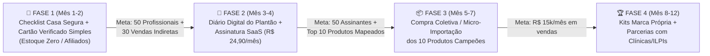
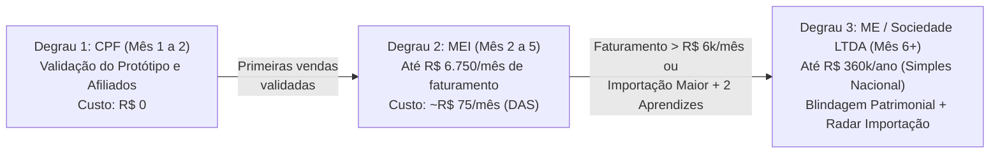

# Relatório Executivo e Plano de Negócios: Ecossistema Digital para Cuidado de Idosos

**Documento preparado para alinhamento de sócios e equipe fundadora:**
* **Tecnologia, Arquitetura e Automação:** Luiz Naveda (Desenvolvimento Web e Produto)
* **Direção Técnica de Enfermagem e Curadoria:** Enfermeira Sênior (Especialista na rotina real do cuidado, dores das famílias e validação clínica)
* **Operação, Comunidade e Atendimento:** 2 Jovens Aprendizes de Enfermagem

---

## 1. Glossário Descomplicado (Para Pessoas Fora do Mercado de Tecnologia)

Antes de avaliarmos os modelos de negócio, traduzimos abaixo os termos do mundo das *startups* para a realidade prática da Enfermagem e do cuidado domiciliar:

* **SaaS (*Software as a Service* ou "Software como Serviço"):**
  É um sistema na internet onde o cliente paga uma pequena assinatura mensal para usar uma ferramenta útil (como a Netflix ou o Spotify, mas para trabalho). No nosso caso, em vez de vender um programa caro, cobramos, por exemplo, **R$ 19,90 ou R$ 29,90 por mês** para que uma família ou profissional use o nosso **Diário Digital do Idoso** ou mantenha seu **Selo Profissional Verificado** ativo na internet.
* **Micro-SaaS:**
  É um SaaS enxuto, focado em resolver **uma dor muito específica** (ex: organizar a rotina do plantão de um idoso acamado), operado por uma equipe pequena (como nós 4), com custo de manutenção quase zero e altíssima margem de lucro.
* **Marketing de Afiliados / *Social Commerce* (Comércio Social):**
  Quando uma enfermeira visita a casa de um idoso e diz à família: *"Vocês precisam comprar um lençol deslizante e uma barra de apoio para evitar quedas"*, a família confia nela e vai comprar. No modelo de **Afiliados**, a enfermeira envia um link da nossa plataforma para a família. Quando a família compra na Amazon, Mercado Livre ou na nossa loja através desse link, nós e a enfermeira ganhamos uma **comissão sobre a venda**, sem precisarmos fabricar o produto.
* **B2B2C (*Business to Business to Consumer*):**
  Significa que nós não precisamos gastar rios de dinheiro tentando achar famílias de idosos na internet. Nós atraímos **os profissionais de enfermagem e cuidadores** (que são nossos parceiros), e **eles** levam a nossa ferramenta para dentro da casa das famílias (os consumidores finais).
* **Compra Coletiva / Importação por Lote:**
  Produtos inovadores para idosos na China custam até 5 vezes menos do que no Brasil. Em vez de comprarmos um estoque gigante no escuro, abrimos um "grupo de compra" na plataforma: quando 20 ou 30 famílias/enfermeiros reservam aquele item, fazemos a importação do lote fechado com lucro alto e risco zero de produto encalhado.
* **AVDs (Atividades da Vida Diária) vs. Produtos Médicos (ANVISA):**
  Pela lei brasileira ([RDC 751/2022 da ANVISA](https://consultas.anvisa.gov.br)), equipamentos médicos invasivos ou clínicos (oxímetros, aparelhos de pressão, sondas, cadeiras de rodas hospitalares) exigem licenças caras para importar. Já os **Produtos de Conforto, Ergonomia e Apoio às AVDs** (como lençóis deslizantes para virar acamados sem dor nas costas, talheres adaptados para quem tem tremor, roupas com abertura fácil para acamados, cintos ergonômicos de apoio e luzes noturnas com sensor de presença) **não são equipamentos médicos**, podendo ser comercializados e importados de forma muito mais simples e segura.
* **MVP (*Minimum Viable Product* ou "Produto Mínimo Viável"):**
  É a primeira versão simples, rápida e funcional do nosso site, lançada gastando quase nada para testar com clientes reais. Só investimos mais dinheiro quando a etapa anterior já estiver dando retorno.

---

## 2. Por Que Nossa Equipe de 4 Pessoas Tem uma Vantagem Única?

A maioria das empresas que tenta entrar nesse mercado fracassa por dois motivos:
1. **Ou são feitas só por programadores** (que nunca entraram no quarto de um idoso acamado e não sabem a diferença entre um *Técnico de Enfermagem com COREN* e um *Cuidador de Idosos*);
2. **Ou são feitas só por profissionais de saúde** (que precisam pagar R$ 80.000 para uma agência criar um site e ficam reféns de custos altos).

**Nós temos a combinação perfeita em casa:**
* **Desenvolvedor (Luiz):** Cria e altera o sistema Web rapidamente a **custo zero de mão de obra de programação**.
* **Enfermeira Sênior (Liderança Clínica):** Traz a visão real do campo — sabe exatamente quais produtos realmente salvam a coluna do cuidador e protegem o idoso, sabe como falar a língua dos colegas de enfermagem e dá **credibilidade imediata** à marca.
* **2 Jovens Aprendizes de Enfermagem (Força Operacional):** Têm conhecimento técnico básico da área para conferir certificados/COREN no computador, montar listas de produtos, gravar vídeos curtos explicativos e dar suporte humanizado pelo WhatsApp para cuidadores e famílias.

---

## 3. As 3 Melhores Opções de Negócio (Com Links de Exemplos Reais)

Abaixo detalhamos as **Opções 2, 4 e 6**, selecionadas por terem **baixo risco jurídico** (não intermediamos o dinheiro do plantão, evitando processos trabalhistas e responsabilidade solidária no Código de Defesa do Consumidor) e **baixo investimento**.

---

### OPÇÃO 2: "Receituário Digital de Conforto & Adaptação" (*Social Care Commerce*)

#### Como funciona na prática:
Quando uma enfermeira ou cuidador avalia um idoso, a família sempre pergunta: *"O que precisamos comprar para cuidar dele em casa?"*.
Na nossa plataforma Web, a enfermeira responde a um **Checklist Rápido de 1 minuto** marcando as condições do idoso (ex: *acamado, risco de queda à noite, dificuldade de segurar talheres, pele sensível*). O sistema gera automaticamente um **Relatório Visual Personalizado ("Plano Casa Segura & Conforto")** e envia no WhatsApp dos filhos do idoso, com a explicação técnica da enfermeira e o botão para comprar cada item ou kit.

* **No início (Estoque Zero):** Os botões de compra levam para produtos selecionados por nós na Amazon, Mercado Livre ou Shopee (usando nossos links de afiliados). O cliente recebe em 24h–48h, nós ganhamos comissão sem ter estoque e descobrimos quais são os produtos campeões de venda.
* **Na sequência (Lotes Próprios / Importação):** Os 10 itens mais vendidos (ex: lençol deslizante para virar acamado, cinto de transferência com alças, abridor ergonômico, sensor de luz para levantar à noite) passam a ser importados por nós em pequenos lotes com **150% a 250% de margem**, pagando uma comissão atrativa para os enfermeiros que indicarem!

#### Exemplos Reais com Links para Conhecer:
* 🔗 **[Fullscript](https://fullscript.com) (EUA/Canadá — Avaliada em +US$ 1 Bilhão):** Maior exemplo mundial desse modelo. Profissionais de saúde montam "receituários digitais de produtos" para seus pacientes; o paciente compra pelo link e o profissional ganha comissão sem precisar ter estoque no consultório.
* 🔗 **[Carewell](https://www.carewell.com) (EUA — +US$ 50 Milhões/ano):** Loja online focada 100% em ajudar famílias de idosos a comprarem os itens certos recomendados por cuidadores e enfermeiros, organizada por necessidades práticas (incontinência, mobilidade, prevenção de quedas, banho).
* 🔗 **[EquipMeOT](https://www.equipmeot.com) (EUA):** Exemplo de como uma profissional de saúde transforma recomendações técnicas de utensílios adaptados para idosos (barras, cintos de transferência, utensílios de banho) em vitrines altamente lucrativas.

---

### OPÇÃO 4: "Diário Digital do Plantão + Alerta de Reposição" (*Micro-SaaS de Rotina*)

#### Como funciona na prática:
Os filhos de um idoso trabalham o dia inteiro preocupados: *"Será que meu pai tomou os remédios? Comeu bem? Quanto deu a pressão? Quem está no plantão hoje?"*. Hoje isso é anotado num caderno de papel (que quem está fora de casa não vê) ou se perde em mensagens soltas no WhatsApp.

Criamos um **Diário Digital Web (acessado direto pelo celular, sem precisar instalar aplicativo pesado)**:
1. Durante o turno, o cuidador ou técnico de enfermagem clica em **botões grandes e visuais** (leva menos de 30 segundos):
   * 💊 Medicação administrada no horário;
   * 🍲 Refeição e hidratação (Comeu tudo / Comeu pouco);
   * ❤️ Sinais vitais básicos (Pressão, Glicemia, Temperatura, Saturação);
   * 🔄 Mudança de decúbito (para acamados, com lembrete de horário!);
   * 📦 **Alerta de Compras:** Botão onde o cuidador avisa: *"Fralda G acabando"*, *"Luva e hidratante no fim"* ou *"Precisamos de protetor de colchão"*.
2. **Para a Família:** Os filhos recebem um resumo organizado no celular (e gráficos para mostrar ao médico geriatra na consulta) + **um link direto para repor com 1 clique os produtos que o cuidador avisou que estão acabando!**

#### Exemplos Reais com Links para Conhecer:
* 🔗 **[Birdie](https://www.birdie.care) (Reino Unido — Levantou +US$ 50 Milhões):** Aplicativo europeu onde o cuidador registra medicamentos, tarefas e sinais no celular, e a família acompanha tudo em tempo real no *Family Circle*.
* 🔗 **[Acvida - Diário do Cuidador](https://acvida.com.br) (Brasil):** Uma das maiores referências brasileiras em cuidadores, que utiliza o conceito do "Diário do Cuidador" como ferramenta central para organizar a rotina na casa da família.
* 🔗 **[Ianacare](https://ianacare.com) (EUA):** Plataforma que organiza a rede de apoio familiar e as necessidades práticas (compras, turnos, medicamentos) ao redor de um idoso.

---

### OPÇÃO 6 (A Combinação Estratégica): "Cartão Profissional Verificado + Receituário + Diário"

#### Como funciona na prática:
A **Opção 6** não obriga a construir tudo de uma vez: ela conecta um **Ímã Gratuito de Profissionais (o Cartão Verificado com Depoimentos)** às ferramentas das **Opções 2 e 4**.

Por que adicionar o **Cartão Profissional Verificado**?
Todo bom enfermeiro, técnico ou cuidador autônomo quer conseguir melhores plantões particulares, mas as famílias têm medo de colocar um desconhecido dentro de casa.
Na nossa plataforma, o profissional cria gratuitamente seu **Perfil Profissional Verificado** (ex: `nossaplataforma.com.br/enfermeira-juliana`), onde nossa equipe (os 2 aprendizes supervisionados pela Enfermeira Sênior) confere e exibe um selo de verificação com:
1. **Registro ativo no COREN** (consultado gratuitamente no site oficial do [COFEN/COREN](https://www.cofen.gov.br)) — diferenciando claramente quem é **Profissional de Enfermagem** de quem é **Cuidador de Idosos (focado apenas em AVDs)**;
2. **Certidão Negativa de Antecedentes Criminais** (emitida gratuitamente no site da [Polícia Federal](https://www.gov.br/pf/pt-br/assuntos/antecedentes-criminais) com código de validação pública);
3. **Certificados de Cursos e Mural de Depoimentos Verificados** (onde famílias reais que já contrataram aquele profissional deixam sua avaliação com telefone/identidade validada).

> [!IMPORTANT]
> **Como eliminamos o risco judicial aqui?**
> A nossa plataforma **NÃO cobra porcentagem sobre o plantão**, **NÃO agenda horários** e **NÃO recebe o pagamento da diária do cuidador**. A família vê o perfil verificado, aceita um termo claro de ciência e clica no botão **"Falar direto no WhatsApp do Profissional"**.
> Com isso, o profissional usa a plataforma todos os dias como seu cartão de visitas oficial, e dentro dela ele usa o **Receituário de Produtos (Opção 2)** e o **Diário do Plantão (Opção 4)** com as famílias!

#### Exemplos Reais com Links para Conhecer:
* 🔗 **[Care.com](https://www.care.com) (EUA):** Maior diretório mundial de cuidadores com checagem de antecedentes (*background check*) e avaliações de famílias.
* 🔗 **[NonnoApp](https://nonnoapp.com) e [Home Angels](https://www.homeangels.com.br) (Brasil):** Mostram o tamanho gigantesco da demanda no Brasil, porém operam no modelo pesado (intermediando plantões ou franquias físicas), o que abre espaço para o nosso modelo leve, digital e focado em ferramentas + produtos.

---

## 4. Plano de Crescimento Escalonado (Lançar 1 Ferramenta por Vez conforme o Sucesso)

Para não termos sobrecarga nem gastos desnecessários, podemos lançar o projeto em **4 Fases Escalonadas**. **Regra de Ouro:** Só avançamos para a fase seguinte quando a fase atual atingir a meta de validação!

### Detalhamento das Fases e Gatilhos:
* **FASE 1 (Meses 1 e 2) — Lançamento Enxuto ("Cartão Verificado + Receituário de Produtos Afiliados"):**
  * Lançamos a ferramenta onde a Enfermeira Sênior e os colegas criam seu **Cartão Verificado com Depoimentos** e geram o **Checklist de Produtos Recomendados** para as famílias.
  * Todos os produtos apontam para links de afiliados ([Amazon Associados](https://associados.amazon.com.br), [Mercado Livre Afiliados](https://www.mercadolivre.com.br/afiliados) e [Shopee](https://affiliate.shopee.com.br)). **Zero custo de estoque.**
  * *Gatilho para ir à Fase 2:* Ter 50 profissionais cadastrados usando o cartão e pelo menos 30 compras realizadas pelas famílias através dos checklists.
* **FASE 2 (Meses 3 e 4) — Retenção Diária ("Diário Digital do Plantão + Reposição"):**
  * Liberamos o módulo do **Diário Digital do Turno** para os cuidadores e famílias que já conheceram a plataforma na Fase 1.
  * Começamos a cobrar uma assinatura acessível (**R$ 24,90/mês** para a família ter o histórico clínico e alertas no WhatsApp, ou **R$ 19,90/mês** para o profissional ter o perfil Pro destacado na busca da cidade).
  * *Gatilho para ir à Fase 3:* Descobrir nos relatórios do sistema quais foram os **5 a 10 produtos não-médicos mais comprados** pelas famílias nos últimos 90 dias.
* **FASE 3 (Meses 5 a 7) — Margem Alta ("Clube de Importação / Lotes Próprios dos Campeões"):**
  * Agora que já sabemos exatamente o que vende (sem adivinhação!), fazemos a primeira compra em lote (via fornecedores do [Alibaba](https://www.alibaba.com) ou importadores atacadistas de São Paulo) dos 5 itens campeões de ergonomia/conforto (ex: *Lençol Deslizante, Cinto de Transferência, Talher Adaptado, Luz de Sensor Noturno, Organizador Inteligente*).
  * Nossa margem no produto salta de ~10% (afiliado) para **150% a 200% (venda direta)**.
* **FASE 4 (Meses 8 a 12) — Escala Regional e Kits Prontos:**
  * Criamos os **"Kits Prontos de Alta Hospitalar"** (ex: quando o idoso vai receber alta do hospital para casa, a família já compra o *Kit Quarto Seguro* completo com 1 clique).

---

## 5. Quadro de Investimentos e Papel das 4 Pessoas em Cada Fase

Como já temos a equipe fundadora (1 Desenvolvedor + 1 Enfermeira Sênior + 2 Aprendizes de Enfermagem), nosso custo fixo inicial é extraordinariamente baixo:

| Fase | Período | Investimento Financeiro Necessário | Onde o Dinheiro é Aplicado | Divisão do Trabalho da Nossa Equipe (4 Pessoas) |
| :--- | :---: | :---: | :--- | :--- |
| **FASE 1** *(Validação & Estoque Zero)* | Mês 1 a 2 | **R$ 150 a R$ 500** *(Total da Fase)* | • Registro do domínio `.com.br` (R$ 40/ano) • Hospedagem/Banco de dados inicial (Grátis) • R$ 100 a R$ 400 em impulsionamento leve no Instagram/WhatsApp para atrair os primeiros profissionais | 👨‍💻 **Luiz (Tech):** Constrói e coloca no ar o Web App (Cartão Verificado + Gerador de Checklist). 👩‍⚕️ **Enfermeira Sênior:** Seleciona os 20 melhores produtos de conforto/segurança e define as perguntas técnicas do Checklist. 🧑‍⚕️ **2 Aprendizes:** Convidam enfermeiros/cuidadores em grupos, conferem certidões do COREN/PF e ajudam a montar os primeiros perfis. |
| **FASE 2** *(Diário Digital & Assinaturas SaaS)* | Mês 3 a 4 | **R$ 500 a R$ 1.200** *(Pago com o retorno da Fase 1)* | • Abertura de CNPJ MEI / Microempresa (se ainda não usar um existente) • Automação de mensagens WhatsApp API (R$ 150/mês) • Tráfego pago focado em famílias procurando cuidadores verificados | 👨‍💻 **Luiz (Tech):** Ativa o Diário Digital do Plantão e cobrança automática via Pix/Cartão. 👩‍⚕️ **Enfermeira Sênior:** Valida o protocolo do Diário de Plantão (sinais vitais, rotina) e grava 3 vídeos curtos dando dicas de cuidado em casa. 🧑‍⚕️ **2 Aprendizes:** Dão suporte no WhatsApp para famílias e cuidadores usando o Diário e auditam os depoimentos enviados. |
| **FASE 3** *(Importação / Estoque dos Top 5 Produtos)* | Mês 5 a 7 | **R$ 2.500 a R$ 5.000** *(Financiado pelo caixa da Fase 2 ou pré-venda em lote)* | • Compra do 1º micro-lote dos 5 produtos campeões de venda (isentos de ANVISA) • Embalagens personalizadas com a nossa marca e QR Code da plataforma | 👨‍💻 **Luiz (Tech):** Ativa a barra de "Compra Coletiva / Lote Aberto" e painel de comissões dos enfermeiros. 👩‍⚕️ **Enfermeira Sênior:** Testa a qualidade física das amostras importadas e aprova os kits. 🧑‍⚕️ **2 Aprendizes:** Embalam e postam os pedidos nos Correios/MelhorEnvio (2x por semana) e gerenciam a rede de enfermeiros afiliados. |
| **FASE 4** *(Escala & Kits de Alta Hospitalar)* | Mês 8 a 12 | **R$ 5.000 a R$ 10.000** *(100% reinvestimento do próprio lucro)* | • Lotes maiores de importação (10 a 15 itens de alta margem) • Assessoria contábil/jurídica para expansão nacional | 👨‍💻 **Luiz (Tech):** Automação de logística e inteligência artificial no Diário. 👩‍⚕️ **Enfermeira Sênior:** Parcerias institucionais com clínicas geriátricas, médicos geriatras e cursos de cuidadores. 🧑‍⚕️ **2 Aprendizes:** Gestão diária de atendimento, expedição de kits e moderação nacional do diretório. |

---

## 6. Tabela de Expectativa de Receita por Fase (Baseada em Volume de Clientes)

Abaixo projetamos a receita bruta mensal somando as **3 fontes de ganho** do ecossistema conforme o projeto amadurece:
1. **Assinaturas do Perfil Pro (Profissionais):** R$ 19,90/mês (para aparecer no topo das buscas da cidade e ter selo renovado).
2. **Assinaturas do Diário Digital (Famílias):** R$ 29,90/mês (para acompanhar o plantão em tempo real, gráficos para o médico e alertas).
3. **Lucro na Venda de Produtos/Kits (Receituário & Reposição):**
   * *Na Fase 1 (Apenas Afiliado Amazon/ML):* Ganho médio líquido de **R$ 18 por pedido** (sobre um carrinho de R$ 180).
   * *Nas Fases 3 e 4 (Com Lotes Próprios/Importados):* Ganho médio líquido de **R$ 95 por Kit vendido** (custo do kit R$ 55 $\rightarrow$ venda por R$ 180 $\rightarrow$ R$ 30 de comissão para o profissional indicador $\rightarrow$ **R$ 95 de margem limpa para nós**).

### Projeção Mensal Escalonada

| Fase do Projeto | Nº de Profissionais Cadastrados *(Grátis + Pagos)* | Nº de Famílias Ativas *(Usando Diário ou Comprando Kits)* | Receita 1: Assinaturas Profissionais *(R$ 19,90)* | Receita 2: Assinaturas Famílias no Diário *(R$ 29,90)* | Receita 3: Margem de Produtos e Kits Vendidos no Mês | **RECEITA LÍQUIDA MENSAL ESTIMADA** |
| :--- | :---: | :---: | :---: | :---: | :---: | :---: |
| **FASE 1 (Mês 2)** *Validação Inicial (Só Afiliados)* | 80 cadastrados *(20 no Plano Pro)* | 40 famílias comprando pelo Checklist | R$ 398 | *(Ainda gratuito para teste)* | 40 pedidos × R$ 18 = **R$ 720** | **R$ 1.118 / mês** *(Valida o modelo com custo zero)* |
| **FASE 2 (Mês 4)** *Ativação do Diário SaaS + Afiliados* | 250 cadastrados *(70 no Plano Pro)* | 80 famílias assinantes + 90 compras no mês | R$ 1.393 | 80 × R$ 29,90 = **R$ 2.392** | 90 pedidos × R$ 25 = **R$ 2.250** | **R$ 6.035 / mês** *(Já paga os aprendizes e gera caixa)* |
| **FASE 3 (Mês 7)** *Primeiros Lotes Importados (Alta Margem)* | 600 cadastrados *(180 no Plano Pro)* | 200 famílias no Diário + 120 Kits Próprios/mês | R$ 3.582 | 200 × R$ 29,90 = **R$ 5.980** | 120 Kits × R$ 95 = **R$ 11.400** | **R$ 20.962 / mês** *(Operação altamente lucrativa)* |
| **FASE 4 (Mês 12)** *Consolidação Regional (Escala)* | 1.500 cadastrados *(450 no Plano Pro)* | 500 famílias no Diário + 300 Kits Próprios/mês | R$ 8.955 | 500 × R$ 29,90 = **R$ 14.950** | 300 Kits × R$ 95 = **R$ 28.500** | **R$ 52.405 / mês** *(Negócio escalável e sólido)* |

> [!TIP]
> **Por que esses números são realistas?**
> Repare que na **Fase 3 (R$ 20.962/mês)** nós não precisamos de milhões de usuários: bastam **180 profissionais assinantes** (menos de 0,1% dos profissionais de enfermagem e cuidadores de um único estado), **200 famílias usando o Diário** e **4 vendas de Kits por dia** (120 no mês) indicadas por toda a rede de profissionais cadastrados!

---

## 7. Guia Prático de Formalização: CPF $\rightarrow$ MEI $\rightarrow$ PJ (LTDA) pelo Caminho

Uma grande vantagem deste modelo de negócio é que **vocês não precisam gastar R$ 2.000 abrindo empresa e pagando contador no Dia 1**. A formalização acompanha o crescimento do faturamento em 3 degraus seguros:

### Degrau 1: Início no CPF (Meses 1 e 2 — Fase de Teste)
* **Por que começar assim:** Nos primeiros 30 a 60 dias, o objetivo é validar se os enfermeiros criam o Cartão Verificado e se as famílias clicam para comprar no Checklist.
* **O que o CPF já permite fazer legalmente:**
  * Registrar o domínio `.com.br` no [Registro.br](https://registro.br);
  * Criar conta e receber comissões na [Amazon Associados](https://associados.amazon.com.br), [Mercado Livre Afiliados](https://www.mercadolivre.com.br/afiliados) e [Shopee Afiliados](https://affiliate.shopee.com.br);
  * Receber pagamentos iniciais via Pix/Asaas/Mercado Pago.
* **Custo mensal:** **R$ 0**.

---

### Degrau 2: Abertura do MEI — Microempreendedor Individual (Meses 2 a 5)
Assim que saírem as primeiras assinaturas e vendas recorrentes, abrimos um **MEI gratuitamente em 10 minutos** no [Portal do Empreendedor (Gov.br)](https://www.gov.br/empresas-e-negocios/pt-br/empreendedor).

> [!IMPORTANT]
> **O Segredo Tributário (Enfermagem vs. Plataforma e Comércio):**
> A profissão regulamentada de Enfermeiro (prestação de serviços clínicos de enfermagem) não pode ser MEI. **PORÉM, a nossa empresa NÃO é uma clínica de enfermagem!** Nossa empresa é uma **vendedora de produtos de conforto/adaptação doméstica, promotora de vendas (afiliados) e portal de conteúdo/treinamento**. Essas atividades **PODEM ser MEI** perfeitamente!

* **CNAEs (Códigos de Atividade) ideais para o nosso MEI:**
  * **Principal (Comércio de Kits/Produtos de Conforto):** `47.59-8-99` (*Comércio varejista de outros artigos de uso pessoal e doméstico*) ou `47.89-0-99` (*Comércio varejista de outros produtos não especificados anteriormente*).
  * **Secundário (Comissões de Afiliados e Divulgação):** `73.19-0-02` (*Promoção de vendas*).
  * **Secundário (Treinamentos/Guias para Famílias e Cuidadores):** `85.99-6-04` (*Treinamento em desenvolvimento profissional e gerencial*).
* **O que o MEI já permite fazer na Fase 2 e início da Fase 3:**
  * Emitir Nota Fiscal de venda dos Kits e de comissão para empresas parceiras;
  * Fazer **importação formal simplificada de pequenos lotes** pelos Correios (*Importa Fácil* / *Minhas Importações* para CNPJ MEI) para revenda legalizada dos utensílios ergonômicos isentos de ANVISA;
  * Ter conta bancária PJ gratuita (Cora, Banco Inter PJ, Nubank PJ) com cobrança automática de Pix/Cartão.
* **Limite de Faturamento:** Até **R$ 81.000 por ano** (média de **R$ 6.750/mês**).
* **Custo mensal:** Apenas o boleto DAS-MEI de **~R$ 75/mês** (não precisa pagar contador mensal).

---

### Degrau 3: Migração para PJ — Microempresa (ME / Sociedade Limitada LTDA no Simples Nacional) (A partir do Mês 5 ou 6)
Quando o negócio entrar na **Fase 3** (ultrapassando R$ 6.500/mês de faturamento ou iniciando importações maiores), transformamos o MEI em uma **ME (Sociedade Empresária Limitada - LTDA)** optante pelo **Simples Nacional**.

* **Por que a Sociedade LTDA é essencial nesta fase:**
  1. **Sociedade Formal entre Vocês Dois:** Vocês passam a constar juntos no Contrato Social com a divisão exata das quotas da empresa.
  2. **Blindagem Patrimonial (Art. 1.052 do Código Civil):** Na LTDA, o patrimônio pessoal de vocês (contas pessoais, carro, bens) fica **separado** das contas e responsabilidades da empresa.
  3. **Contratação dos 2 Jovens Aprendizes:** O MEI só permite 1 funcionário; já a **ME (LTDA)** permite contratar formalmente os **2 jovens aprendizes** (via programas como [CIEE](https://portal.ciee.org.br) ou SENAC, que têm encargos trabalhistas reduzidos — FGTS de apenas 2%!) ou contratá-los como estagiários de enfermagem (zero encargos de FGTS/INSS, apenas bolsa-auxílio + seguro de vida de R$ 15/mês!).
  4. **Habilitação no RADAR / Siscomex (Importação Direta da China):** Com a ME ativa, habilitamos gratuitamente o **Radar Expresso** no portal [Siscomex da Receita Federal](https://www.gov.br/receitafederal/pt-br/assuntos/aduana-e-comercio-exterior), permitindo importar até US$ 50.000 por semestre diretamente de fábricas verificadas no Alibaba com nota fiscal de entrada e total segurança.
* **Custo de abertura e manutenção da ME:**
  * Abertura via contabilidade online ([Contabilizei](https://www.contabilizei.com.br) ou [Agilize](https://agilize.com.br)): taxa única de junta comercial (~R$ 300 a R$ 600) + mensalidade contábil de ~R$ 190/mês + imposto do Simples Nacional (que começa em apenas **4% sobre a venda de produtos** no Anexo I e **6% sobre serviços/SaaS** no Anexo III).

> [!TIP]
> **Dica de Ouro para os 2 Aprendizes de Enfermagem:**
> Em vez de "Jovem Aprendiz CLT" (que exige vínculo CLT), se eles estiverem cursando **Técnico de Enfermagem ou Graduação em Enfermagem**, vocês podem contratá-los pela **Lei do Estágio (Lei nº 11.788/2008)** através do CIEE ou Nube! O estagiário não tem FGTS, não tem 13º, não tem multa de 40% de rescisão e pode cumprir de 20h a 30h semanais ajudando na curadoria clínica e verificação do diretório sob supervisão da sua namorada (que é Enfermeira formada)!

---

## 8. Avaliação Completa de Riscos Legais e Protocolo de Blindagem

O setor de cuidado de idosos envolve uma população considerada **hipervulnerável** pela Justiça brasileira ([Estatuto da Pessoa Idosa — Lei nº 10.741/2003](https://www.planalto.gov.br/ccivil_03/leis/2003/l10.741.htm)). Por isso, mapeamos abaixo as **6 frentes de risco legal** que costumam inviabilizar agências tradicionais e detalhamos **como a nossa arquitetura neutraliza cada uma delas**:

### Matriz de Exposição Legal e Mecanismos de Proteção

| Frente de Risco | Legislação Aplicável | Por que outros negócios têm problemas? | Como o Nosso Modelo Neutraliza o Risco (Blindagem) |
| :--- | :--- | :--- | :--- |
| **1. Responsabilidade Civil por Acidentes, Quedas, Erros ou Furtos na Casa do Idoso** | • [Código de Defesa do Consumidor (Art. 14)](https://www.planalto.gov.br/ccivil_03/leis/l8078compilado.htm) • Jurisprudência do STJ • Estatuto da Pessoa Idosa | Quando um aplicativo ou agência **cobra comissão sobre o plantão, define o preço da diária, escala o cuidador ou promete "garantia de segurança"**, o STJ entende que a plataforma faz parte da cadeia de fornecimento e responde **solidariamente** (paga indenização junto com o cuidador). | **🟢 RISCO MÍNIMO (Desacoplamento):** 1. **Não intermediamos o pagamento do plantão** nem agendamos escalas. 2. Somos juridicamente um **Birô de Verificação Documental e Software de Rotina**. 3. A família aceita um **Termo de Ciência** (com registro de IP/data) antes de abrir o WhatsApp do profissional, reconhecendo que a contratação e supervisão são diretas. |
| **2. Exercício Ilegal da Enfermagem por Cuidadores de Idosos** | • [Lei do Exercício Profissional da Enfermagem (Lei nº 7.498/86)](https://www.planalto.gov.br/ccivil_03/leis/l7498.htm) • [Parecer COREN-SP nº 020/2014](https://portal.coren-sp.gov.br) • CBO 5162-10 | Muitas plataformas misturam "Cuidador" com "Técnico de Enfermagem", permitindo que cuidadores façam aspiração, sondagem, curativos complexos ou injetáveis. Isso gera fiscalização do COREN e responsabilidade criminal/civil. | **🟢 RISCO ZERO / CONTROLADO:** 1. Separação visual obrigatória no cadastro e no cartão público:    • **Enfermeiro / Técnico (COREN Ativo):** Habilitado para procedimentos técnicos.    • **Cuidador de Idosos (CBO 5162-10):** Tarja visível informando atuação restrita às **AVDs** (higiene, alimentação, companhia), sendo **vedados procedimentos invasivos**. |
| **3. Risco Trabalhista (Vínculo CLT de Cuidadores contra a Plataforma)** | • Consolidação das Leis do Trabalho (Art. 3º da CLT) • LC nº 150/2015 (PEC das Domésticas) | Agências que exigem exclusividade, aplicam punições, controlam horário de entrada/saída do plantão e pagam o cuidador toda semana sofrem processos trabalhistas milionários. | **🟢 RISCO ZERO:** Não há subordinação, não há habitualidade imposta por nós e não há pagamento de salários/diárias pela plataforma. O profissional é **nosso cliente/usuário** (usa nosso cartão digital e ganha bônus de afiliado sobre vendas de produtos). |
| **4. Risco Sanitário em Produtos e Importação (ANVISA)** | • [RDC ANVISA nº 751/2022](https://consultas.anvisa.gov.br) (Dispositivos Médicos) • Lei nº 6.360/76 | Lojas que fazem *dropshipping* internacional de aparelhos de pressão, oxímetros, colchões hospitalares terapêuticos ou curativos sem registro na ANVISA e sem AFE (Autorização de Funcionamento) sofrem apreensão na Receita Federal e multa sanitária. | **🟢 RISCO ZERO / BAIXO:** 1. **Produtos médicos/correlatos (Fases 1 a 4):** Vendidos **exclusivamente via link de Afiliado Nacional** (Amazon/Mercado Livre/Distribuidores brasileiros que já possuem registro ANVISA e emitem a NF direta ao consumidor). 2. **Importação Própria (Fase 3):** Restrita 100% a **utensílios domésticos, têxteis ergonômicos, organizadores e iluminação** (isentos de ANVISA) e sem alegação clínica/terapêutica. |
| **5. Ética Profissional na Indicação de Produtos (COFEN / CFM)** | • [Código de Ética dos Profissionais de Enfermagem (Res. COFEN nº 564/2017)](https://www.cofen.gov.br/resolucao-cofen-no-5642017/) | O Código de Ética proíbe associar o serviço clínico de enfermagem a práticas mercantilistas enganosas ou venda casada obrigatória de medicamentos/órteses. | **🟢 RISCO BAIXO (Transparência):** 1. Os produtos recomendados no *Checklist* são de **conforto, prevenção de quedas e ergonomia doméstica** (não medicamentos). 2. A compra pela família é 100% opcional (o relatório mostra as especificações do item, e a família compra onde quiser ou usa a comodidade do nosso link com aviso transparente de "Link Parceiro"). |
| **6. Proteção de Dados de Saúde do Idoso (LGPD)** | • [Lei Geral de Proteção de Dados (Lei nº 13.709/2018 — Art. 11 Dados Sensíveis)](https://www.planalto.gov.br/ccivil_03/_ato2015-2018/2018/lei/l13709.htm) | Guardar prontuários médicos completos identificados com CPF, endereço e doenças graves do idoso sem segurança pode gerar multas e processos por vazamento. | **🟢 RISCO BAIXO (Minimização de Dados):** No *Diário Digital do Turno*, não exigimos CPF nem nome completo do idoso (apenas apelido/primeiro nome, ex: *"Dona Helena"*), não armazenamos laudos médicos sigilosos e o acesso é protegido por link privado exclusivo da família. |

---

### As 5 Regras de Ouro de Segurança Jurídica para Nossa Equipe

Para que a Enfermeira Sênior e os 2 Aprendizes trabalhem com tranquilidade absoluta no dia a dia:

1. **Linguagem Factual no Selo (Nunca prometer "Garantia de Comportamento"):**
   * ❌ **Proibido escrever no site:** *"Garantimos profissionais 100% seguros e de total confiança para seu idoso."*
   * ✅ **Como escreveremos:** *"Perfil com Documentação Auditada: Identidade Civil, Registro COREN e Certidão Negativa da Polícia Federal conferidos nas bases públicas oficiais em [Data da Conferência]."*
2. **Validade de 90 Dias para Certidões:**
   * O sistema avisará automaticamente a cada 90 dias para o profissional atualizar sua Certidão Negativa gratuita da Polícia Federal, mantendo o histórico de diligência da plataforma sempre em dia.
3. **Proibição de "Diagnóstico Médico" no Checklist Web:**
   * O gerador de *Checklist Casa Segura* nunca dirá *"Prescrição para cura de úlcera de pressão"*, e sim **"Recomendações de Conforto, Ergonomia Doméstica e Prevenção de Acidentes nas Atividades da Vida Diária (AVDs)"**.
4. **Canal de Denúncia Imediata ("Botão de Suspensão Preventiva"):**
   * Todo perfil terá um botão discreto *"Reportar conduta ou divergência cadastral"*. Se qualquer família relatar comportamento inadequado de um cuidador ou profissional, o perfil é ocultado preventivamente em 1 clique até apuração.
5. **Separação Patrimonial na Fase de Escala (LTDA):**
   * Conforme detalhado na Seção 7, assim que o projeto entrar na fase de estoque próprio e maior volume (Fase 3), operará sob uma **Sociedade Limitada (LTDA)**, blindando o patrimônio pessoal dos sócios.

---

## 9. Próximos Passos Práticos para a Equipe (Esta Semana)

1. **Avaliação Clínica (Enfermeira Sênior + 2 Aprendizes/Estagiários):**
   - Ler este documento e aprovar a estratégia de começar pela **Fase 1 (Cartão Verificado + Gerador de Checklist de Casa Segura)** acoplando o **Diário Digital Simples**, iniciando no CPF/MEI com custo zero.
   - Listar os **15 produtos mais úteis no dia a dia de um idoso em casa** (ex: *lençol deslizante para movimentação no leito, cinto de transferência, barra de apoio, tapete antiderrapante, luz com sensor de presença, hidratante/creme de barreira, espessante, organizador de comprimidos, calçador de meias, talher adaptado*).
2. **Desenvolvimento do Protótipo Interativo (Luiz):**
   - Abrir o arquivo `index.html` na pasta do projeto e testar juntos as **5 abas funcionais** (incluindo a nova aba `5. Riscos Legais & Blindagem`)!
